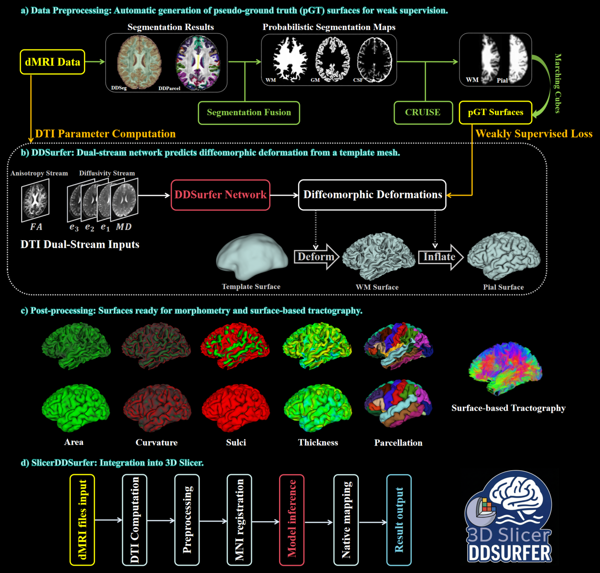

<div align="center">

# DDSurfer

**基于扩散磁共振成像的皮层表面重建**

[](#key-dependencies)
[](#key-dependencies)
[](#key-dependencies)
[](#key-dependencies)
[](#key-dependencies)
[](#optional-postprocessing)

[论文](#publication) | [方法概览](#overview) | [安装](#installation) | [运行 DDSurfer](#run-ddsurfer) | [后处理](#optional-postprocessing) | [依赖配置](#key-dependencies) | [English](README.md)

</div>

DDSurfer 从扩散磁共振图像重建左右半球的皮层内表面（白质表面，WM）
和皮层外表面（软脑膜表面，pial）。项目将预处理、皮层表面推理和可选后处理
整合为一套流程，并自动加载 `weights/` 中的模型权重。

**输入扩散磁共振数据，获得双侧半球的白质与软脑膜表面。**

---

<a id="publication"></a>

## 论文

DDSurfer 已发表于 **Advanced Science**：

> Chengjin Li, Wei Zhang, Xi Zhu, Yuqian Chen, Nir A. Sochen, Jarrett Rushmore,
> Carl-Fredrik Westin, Yogesh Rathi, Lauren J. O'Donnell, Ofer Pasternak, and
> Fan Zhang. ["DDSurfer: A Weakly-Supervised Dual-Stream Deep Learning Framework
> for Cortical Surface Reconstruction From Diffusion MRI."](https://doi.org/10.1002/advs.76596)
> *Advanced Science* **13**(56), e76596 (2026).

如果在学术研究中使用 DDSurfer，请引用我们的论文。
机器可读的引用信息见 [CITATION.cff](CITATION.cff)。

<a id="citation-bibtex"></a>

### 引用格式（BibTeX）

```bibtex
@article{Li2026DDSurfer,
  author  = {Li, Chengjin and Zhang, Wei and Zhu, Xi and Chen, Yuqian and
             Sochen, Nir A. and Rushmore, Jarrett and Westin, Carl-Fredrik and
             Rathi, Yogesh and O'Donnell, Lauren J. and Pasternak, Ofer and
             Zhang, Fan},
  title   = {DDSurfer: A Weakly-Supervised Dual-Stream Deep Learning Framework
             for Cortical Surface Reconstruction From Diffusion MRI},
  journal = {Advanced Science},
  year    = {2026},
  volume  = {13},
  number  = {56},
  pages   = {e76596},
  doi     = {10.1002/advs.76596},
  url     = {https://doi.org/10.1002/advs.76596}
}
```

---

<a id="overview"></a>

## 方法概览



**核心功能：** 弱监督学习、白质与软脑膜表面重建、基于表面的分析，以及与 3D Slicer 的集成。

---

<a id="installation"></a>

## 安装

克隆仓库并进入项目目录：

```bash
git clone https://github.com/ChengjinLii/DDSurfer.git
cd DDSurfer
```

仓库已包含模型权重。运行前，请配置 [Python 环境](#python-environment)，
并安装所需的 [外部应用](#key-dependencies)。下文命令均在仓库根目录执行。

---

<a id="inputs"></a>

## 输入数据

提供已完成校正的四维 DWI、bval、bvec，以及与 DWI 处于同一原生体素网格的脑掩膜。
不需要预先计算 DTI，也不需要结构 MRI。没有脑掩膜时，可启用
[可选脑掩膜生成](#optional-brain-masking)，该功能默认关闭。

```text
inputs/<subID>/
  dwi.nii.gz
  dwi.bval
  dwi.bvec
  mask.nii.gz
```

**运行前须完成：** 头动、涡流和磁敏感畸变校正，并同步更新相应的梯度信息。

---

<a id="run-ddsurfer"></a>

## 运行 DDSurfer

<a id="quick-start"></a>

### 快速开始

在仓库根目录执行：

```bash
python3 run_ddsurfer_pipeline.py --subject <subID>
# 等价的 Shell 入口：
bash run_ddsurfer_pipeline.sh --subject <subID>
```

如果输入文件存放在其他位置，可显式指定路径：

```bash
python3 run_ddsurfer_pipeline.py --subject <subID> \
  --dwi ./data/dwi.nii.gz --bval ./data/dwi.bval \
  --bvec ./data/dwi.bvec --mask ./data/mask.nii.gz
```

<a id="workflow"></a>

### 处理流程

`DWI -> DTI 特征 -> MNI 空间推理 -> 原生空间表面`

表面预测前会自动执行预处理。默认目录为：

- 输入：`inputs/<subID>/`
- 输出：`outputs/<subID>/`

<a id="common-options"></a>

### 常用选项

| 选项 | 用途 |
| --- | --- |
| `--raw-input-root <path>` | 修改输入根目录。 |
| `--output-root <path>` | 修改输出根目录。 |
| `--device cuda:0` 或 `--device cpu` | 选择 GPU 或 CPU 推理。 |
| `--precision fp32` | CPU 和 GPU 均默认使用 FP32；便于在相同精度下比较设备。 |
| `--precision bf16` | 使用可选混合精度以降低显存占用；需要支持 BF16 的 CUDA 硬件。 |
| `--precision auto` | CUDA 上遵循模型清单的精度设置，随附模型为 FP32；CPU 上使用 FP32。 |
| `--cpu-threads 4` | 推理阶段的 CPU 线程预算，默认 4。 |
| `--max-gpu-gib 24` | 推理阶段的显存分配预算，单位 GiB，默认 24。 |
| `--auto-mask` | 使用 FreeSurfer SynthStrip 生成缺失的脑掩膜，默认关闭。 |
| `--preprocess-jobs 2` | 并行运行相互独立的 DTI 处理阶段，默认并发数为 1。 |
| `--post-process` | 启用可选的 FreeSurfer 后处理，默认关闭。 |
| `--keep-cache` | 保留中间文件及各阶段的详细日志。 |
| `--resume` | 复用已完成且通过校验和验证的最终结果，即使中间缓存已被清理。 |

图像处理开始前，主流程会检查输入、模型文件、设备与精度支持，以及所需的 Slicer 模块。
仅在启用后处理时检查对应的 FreeSurfer 工具、许可证和图谱文件；自动脑掩膜生成则单独检查 SynthStrip。
贯穿整个个体处理过程的运行锁，可防止两次主流程同时写入同一输出目录或清理对方的缓存。

资源限制只作用于**推理阶段**，不包括配准或后处理。
CUDA 推理要求至少 8 GiB 的显存预算，并额外预留 4 GiB 的可用显存余量。
预检不能阻止其他进程随后占用 GPU。

<a id="cpu-and-gpu-precision"></a>

### CPU 与 GPU 的数值精度

CPU 和 GPU 推理使用**相同的模型与坐标变换**，且**默认均为 FP32**。
两者结果应接近，但不保证跨设备逐位一致。

在任一设备上显式使用 FP32：

```bash
python3 run_ddsurfer_pipeline.py --subject <subID> --device cpu --precision fp32
python3 run_ddsurfer_pipeline.py --subject <subID> --device cuda:0 --precision fp32
```

显存不足时，可在支持的硬件上主动选择 BF16：

```bash
python3 run_ddsurfer_pipeline.py --subject <subID> --device cuda:0 --precision bf16
```

程序不会自动降低精度。BF16 会降低数值精度，并可能改变表面顶点坐标，
因此它不只是计算更快的执行方式。

比较设备时，应保持预处理输入、权重和其他设置一致。
详见 [PyTorch 数值精度说明](https://docs.pytorch.org/docs/stable/notes/numerical_accuracy.html)。

<a id="cache-and-reuse"></a>

### 缓存与结果复用

DTI 参数图和表面会自动保存。流程成功后清理中间缓存；失败时保留缓存以便排查。
源输入文件不会被修改或删除。

无需保留缓存也能复用最终结果：

```bash
python3 run_ddsurfer_pipeline.py --subject <subID> --resume
```

复用要求已有成功运行记录，且输入、权重、模板、参数、代码实现及输出校验和均匹配。
不满足条件时，程序会尝试正常运行；已有的缓存和输入安全检查仍然生效。
没有复用记录的旧结果不会直接跳过。添加 `--resume` 时应保留原运行选项；
结果复用不会重建已经删除的缓存。

`--skip-preprocessing` 的作用不同：它直接使用此前保留的预处理缓存，
不能与 `--resume` 同时使用。

检查随附模型权重的完整性：

```bash
(cd weights && sha256sum -c SHA256SUMS)
```

---

<a id="optional-brain-masking"></a>

## 可选脑掩膜生成

没有脑掩膜时，添加 `--auto-mask`：

```bash
python3 run_ddsurfer_pipeline.py --subject <subID> --auto-mask
# 也可显式提供三份扩散数据文件：
python3 run_ddsurfer_pipeline.py --subject <subID> --auto-mask \
  --dwi ./data/dwi.nii.gz --bval ./data/dwi.bval --bvec ./data/dwi.bvec
```

- **默认关闭：** 未启用此选项时，必须提供脑掩膜。
- **方法：** 对平均 b0 图像（`b <= 50`）运行 FreeSurfer `mri_synthstrip`。
- **配置：** 设置 `FREESURFER_HOME`，或传入 `--freesurfer-home <path>`。
- **执行：** 仅使用 CPU；通过 `--mask-threads 4` 设置线程预算。
- **输出：** `dti/<subID>-brainmask.nii.gz`，清理缓存后仍保留。

用户提供的掩膜始终优先。自动生成不会替换已有掩膜，也不会连带启用表面后处理。
用于分析前应检查生成掩膜的质量；它不一定与人工提供的掩膜一致。
详见 [脑掩膜生成与验证](preprocessing/README.zh-CN.md#optional-brain-masking)。

---

<a id="outputs"></a>

## 输出结果

每次运行均保留 DTI 参数图、重建表面及简要日志。
FreeSurfer 分析目录**仅在启用 `--post-process` 时生成**：

```text
outputs/<subID>/
  dti/
    <subID>-FA.nii.gz
    <subID>-MD.nii.gz
    <subID>-MinEigenvalue.nii.gz
    <subID>-MidEigenvalue.nii.gz
    <subID>-MaxEigenvalue.nii.gz
    <subID>-Trace.nii.gz
    <subID>-brainmask.nii.gz   仅在使用 --auto-mask 生成时保存
  ddsurfer/
    lh.white.obj
    lh.pial.obj
    rh.white.obj
    rh.pial.obj
  surf/                      可选后处理结果
    lh.white, lh.pial, rh.white, rh.pial
    lh.curv, lh.sulc, lh.thickness, lh.area
    lh.inflated, lh.sphere, lh.sphere.reg
    rh.*                     对应的右半球结果
  label/                     可选皮层标签与分区
    lh.cortex.label, rh.cortex.label
    lh.aparc.annot, rh.aparc.annot
    lh.aparc.a2009s.annot, rh.aparc.a2009s.annot
  stats/                     可选脑区表面统计
    lh.aparc.stats, rh.aparc.stats
    lh.aparc.a2009s.stats, rh.aparc.a2009s.stats
  fsaverage/                 可选标准表面标量数据
    lh.thickness.mgh, rh.thickness.mgh, ...
  mri/                       可选 FreeSurfer 参考体积
    brain.mgz, orig.mgz
  logs/                      运行摘要与执行日志
```

实际后处理文件取决于所选图谱和半球。
文件类型与结果含义见 [后处理输出说明](postprocessing/README.zh-CN.md#outputs)。

---

<a id="optional-postprocessing"></a>

## 可选后处理

**即插即用的皮层表面分析流程，默认关闭。** 配置 FreeSurfer、许可证和 `fsaverage` 后即可启用：

```bash
python3 run_ddsurfer_pipeline.py --subject <subID> --post-process
```

后处理也可独立接收其他重建方法生成的四份原生空间白质与软脑膜表面，
无需 DWI、DTI 或结构 MRI。结果包括曲率、沟深、厚度、面积、皮层分区、脑区统计，
以及映射到 fsaverage 的表面标量数据。
通过 Python 标签导出、共享数据读取与映射，以及经验证的阶段复用，
减少重复工作，同时保留 FreeSurfer 的核心算法。

详见**[后处理使用指南](postprocessing/README.zh-CN.md)**，其中介绍了
[处理流程](postprocessing/README.zh-CN.md#workflow)、独立运行方式、输入要求，
以及 [优化措施与实测收益](postprocessing/README.zh-CN.md#optimizations-over-freesurfer)。

---

<a id="key-dependencies"></a>

## 依赖配置

| 组件 | 用途 | 要求 |
| --- | --- | --- |
| Python 3.8+ | 主流程与辅助工具 | 必需。 |
| PyTorch、torchvision | 表面推理 | 必需；CUDA 可选。 |
| NumPy、SciPy、SimpleITK、nibabel、trimesh、pynrrd | 图像与表面处理 | 必需。 |
| Slicer 及 SlicerDMRI | 原始 DWI 处理 | 设置 `SLICER_PATH`，或将 `Slicer` 加入 `PATH`。 |
| FreeSurfer | 可选脑掩膜生成与表面后处理 | 脑掩膜生成需要 `mri_synthstrip`；后处理还需许可证和 `fsaverage`。 |

<a id="python-environment"></a>

### Python 环境

预处理、推理和后处理的 Python 依赖统一定义在根目录的
[`requirements.txt`](requirements.txt) 中。
根目录的 [`environment.yml`](environment.yml) 可创建 `ddsurfer` conda 环境，
并安装同一套依赖。在仓库根目录执行：

```bash
conda env create -f environment.yml
conda activate ddsurfer
```

也可安装到已有的兼容 Python 环境：

```bash
python -m pip install -r requirements.txt
```

Slicer/SlicerDMRI 和可选的 FreeSurfer 是独立的外部应用，需另行安装，
上述 Python 依赖文件不会安装这些应用。

可选训练辅助模块 [`utils/loss.py`](utils/loss.py) 提供原版的单向 Chamfer 边界损失。
使用时需单独安装 [与当前环境兼容的 PyTorch3D](https://github.com/facebookresearch/pytorch3d/blob/main/INSTALL.md)；
推理主流程不导入该模块，也不依赖 PyTorch3D。

<a id="environment-check"></a>

### 环境检查

处理个体前，可先检查当前激活的环境：

```bash
python tests/check_environment.py
```

脚本检查 Python 包能否导入、版本是否匹配，以及原始 DWI 预处理所需的
Slicer/SlicerDMRI 命令行模块文件。若还需检查 CUDA GPU 和可选 FreeSurfer 组件：

```bash
python tests/check_environment.py --device cuda:0 --post-process --auto-mask
```

- 添加 `--precision bf16` 可检查所选 GPU 的 BF16 支持；默认精度为 FP32。
- FreeSurfer 检查为可选项。启用时需设置 `FREESURFER_HOME`，或传入 `--freesurfer-home`。
- 仅在不需要检查原始 DWI 预处理环境时，才使用 `--skip-slicer`。

缺少组件时，脚本会给出安装命令、下载链接或配置提示，不会自动安装，
也不会执行数据处理或模型推理。
请求的检查没有失败时，退出状态为 `0`，但仍可能存在警告；必需组件检查失败时为 `1`。
此检查不实际执行外部工具，不验证许可证是否有效，也不判断可用内存或显存是否足以完成整次推理。

---

<a id="slicer-extension"></a>

## Slicer 扩展

**SlicerDDSurfer 即将开源**，仓库地址：
[ChengjinLii/SlicerDDSurfer](https://github.com/ChengjinLii/SlicerDDSurfer)。

输出的 OBJ 表面在文件头声明 `SPACE=RAS`，以便 3D Slicer 自动识别坐标系。
对于没有该声明的旧文件，请在 Slicer 的 Add Data 加载选项中手动选择 **RAS**。

---

<a id="license"></a>

## 许可证

DDSurfer 使用 [MIT 许可证](LICENSE)。第三方组件和外部工具仍遵循各自的许可证。

---

<a id="support"></a>

## 问题与反馈

如有使用问题、缺陷报告或功能建议，请提交
[GitHub issue](https://github.com/ChengjinLii/DDSurfer/issues)。

---

<a id="acknowledgments"></a>

## 致谢

本研究部分受国家重点研发计划（项目编号：2023YFE0118600）
和国家自然科学基金（项目编号：62371107）资助。
